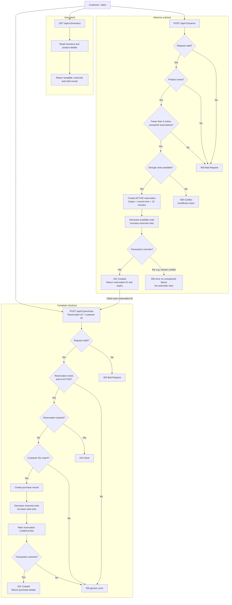

# Phone Launch Reservation Backend

Spring Boot prototype for reserving a phone variant during checkout and
recording a completed purchase.

## What the service does

- Stores a separate inventory record for each product variant.
- Moves units from available to reserved when a reservation succeeds.
- Records an expiry time 15 minutes after the reservation is created.
- Moves units from reserved to sold when an active, unexpired reservation is
  completed.
- Exposes an inventory endpoint for a stock banner.

The intended inventory accounting is:

```text
total units = available units + reserved units + sold units
```

Inventory changes are made inside Spring transactions. The `VERSION` field on
the inventory entity enables Hibernate optimistic locking: a conflicting update
fails rather than silently overwriting a newer inventory update. The application
does not currently retry that conflict, and a client can receive a generic 500.
This mechanism alone does not establish end-to-end correctness under load.

## Application flow

The diagram shows the current implementation, including its limitations. The
customer can check stock, reserve a variant, and then complete the purchase.
Inventory changes are persisted to the configured H2 database.



**Expiry limitation:** The service has a method to release expired
reservations, but it is not scheduled or called automatically. Passing the
expiry time alone does not return the held units to available stock. The
purchase customer-ID comparison also does not authenticate the customer.

## Assumptions and decisions

| Decision | Current behavior and rationale |
| --- | --- |
| Variant inventory | Each model, color, and storage combination has its own product and stock record. This allows each variant to sell out independently. |
| Initial stock | The H2 seed data has 2,500 Space Black 256 GB units and 2,000 Gold 256 GB units. These are sample quantities, not live supply. |
| Hold duration | A reservation expires after 15 minutes, allowing time for checkout. This is a demo choice, not a measured checkout requirement. |
| Quantity | A request can reserve 1 to 5 units. Separately, the service checks for fewer than 5 active, unexpired reservations per customer. This is a reservation count, not a 5-unit customer-wide cap; concurrent requests can bypass the count check. |
| Checkout | A completed purchase records a sale; plan selection, credit checks, and payment processing are outside the prototype. |
| Customer identity | A caller supplies `customerId`. The purchase code checks it against the reservation, but there is no authentication to prove that the caller owns that ID. |
| Launch time | No 8:00 AM Eastern launch gate is implemented. Timestamps use the server's local time without an explicit time zone. |
| Storage | The configured database is in-memory H2 for demonstration. Data is lost when the application stops. |

The seed data and schema used by the configured application are in
[`src/main/resources/schema.sql`](src/main/resources/schema.sql). The root-level
`schema.sql` is a separate Oracle-oriented script and is not the schema
configured for the H2 application.

## Run locally

### Prerequisites

- JDK 17
- Maven installed and available on `PATH`
- An available TCP port 8080

From the project directory:

```powershell
mvn spring-boot:run
```


The default base URL is `http://localhost:8080`. H2 console is at
`http://localhost:8080/h2-console`, with JDBC URL `jdbc:h2:mem:testdb`, user
`sa`, and an empty password. The console and database settings are for local
development only. Restarting the process resets the in-memory data.

## API examples

Send JSON with `Content-Type: application/json`.

### Reserve

`POST /api/v1/reserve`

```json
{
  "productId": 1,
  "customerId": "Taslima",
  "quantity": 1,
  "sessionToken": "session-123",
  "deviceFingerprint": "device-123"
}
```

On success, the response is HTTP 201 and includes `reservationId`, `status`,
and `expiresAt`. Save the returned reservation ID for the purchase request.
Insufficient stock returns 409. An unknown product or an existing count of
5 active, unexpired reservations returns 400. Request validation also rejects
missing fields and quantities outside 1-5.

`sessionToken` and `deviceFingerprint` are stored, but are **not** used to
deduplicate requests or enforce device limits. Do not assume retrying a request
is safe.

### Complete purchase

`POST /api/v1/purchase`

```json
{
  "reservationId": 1,
  "customerId": "Taslima"
}
```

Use the ID returned by the reservation. A successful response is HTTP 201.
An active reservation that has passed its expiry is rejected with 410.
An owner mismatch is currently caught as a generic 500, not a dedicated
authorization response. An already completed reservation is also rejected
through the generic error path.

### Inventory and health

- `GET /api/v1/inventory`: returns product details and available, reserved,
  and sold counts. `soldPercentage` is based on sold units, not reserved units.
- `GET /api/v1/health`: returns a basic service status message.

## What could go wrong

| Risk | Current handling or gap |
| --- | --- |
| Two requests update the same inventory row | `@Version` detects conflicting updates and the transaction can roll back. There is no bounded retry or tailored conflict response. |
| Checkout abandoned | Purchase checks the expiry, and a release method exists. **Nothing schedules that method**, so expired stock is not automatically returned to available inventory. |
| Repeat request or lost response | No idempotency key is enforced. A retry or double-tap may create another reservation. A completed purchase retry is not returned as the original result. |
| Identity spoofing | The supplied customer ID can be impersonated. Authentication and authorization based on a trusted identity are missing. |
| Customer limit under concurrency | Counting and creating reservations are separate operations. Simultaneous requests can both pass the count check; completed purchases do not count toward the active limit. |
| Purchase and expiry races | Reservation rows have no version or explicit locking. Concurrent purchase and expiry transitions have not been proven safe. |
| Purchase history price | The purchase service does not populate `UNIT_PRICE`; the H2 schema permits null even though the entity marks the field non-null. A test for recording this price is skipped until the defect is fixed. |
| Missing inventory or cleanup failure | The expiry method skips missing inventory and catches errors. Its behavior and recovery need hardening and integration tests. |
| Process restart or multiple instances | In-memory H2 is not durable or shared across application processes; a restart loses reservations and sales. |
| Stock display | The endpoint reads the database for each call; there is no push, cache, or measured freshness guarantee. Inventory lookup also performs a product lookup per row. |
| Inventory mapping | The service looks up inventory by `productId` through the inventory primary key. This only works when `inventoryId` equals `productId`, as in the seed data. |

The current implementation does not guarantee no overselling or duplicate
sales across all failure and concurrency scenarios. It requires more
database-backed concurrency testing and further design work before production use.


## Measured performance

The following is an **exploratory local measurement**, not a load test:

| Item | Observed value |
| --- | --- |
| Date and endpoint | 24 November 2026, `GET /api/v1/inventory` |
| Environment | Windows, local loopback; 14 logical processors, about 16.6 GB RAM |
| Method | PowerShell `Invoke-WebRequest`, one warm-up, then 20 sequential requests; concurrency 1 |
| Successful responses | 20 of 20 HTTP 200 |
| Mean / median | 22.07 ms / 21.30 ms |
| p95 / minimum / maximum | 25.95 ms / 19.79 ms / 29.17 ms |

Latency was measured around the complete HTTP call with a stopwatch; p95 is
the 19th sorted observation (nearest-rank method). The server was already
running and its exact build and runtime environment were not verified, so these
numbers are **not a benchmark of the current source revision**. Client overhead,
machine activity, and the small sample affect results. No reservation throughput,
concurrent latency, error rate under load, or 8:00 AM spike capacity has been
measured. No claim is made about 10,000 users or launch-day readiness.

For a representative benchmark, use an isolated deployment and seeded database,
record the commit/build and hardware, and run repeatable warm-up, sustained,
and burst tests. Report request mix, concurrency, duration, throughput, p50,
p95, p99, errors, database utilization, and inventory invariants. Test reserve
and purchase operations as well as banner reads.

## If next year's launch is 10x bigger

The first bottleneck is **not measured**. Likely pressure points to validate are:

1. A popular variant's single inventory row: more simultaneous writes cause
   optimistic-lock conflicts and failed requests.
2. Reservation processing: `findAll()` loads all reservations to count one
   customer's active holds, increasing database and memory work as history grows.
3. Inventory reads: every banner request reads all inventory and performs
   additional product lookups.
4. The single-process H2 database: it cannot provide durable shared state for
   independently scaled application instances.

Move to a durable shared database, use indexed queries and an atomic customer
limit, and introduce bounded retries with idempotency. Evaluate caching for
banner reads with an explicit freshness target, admission control for launch
bursts, and scaling or partitioning only after profiling the actual bottleneck.
Any queue or stock-allocation design must preserve inventory correctness.

## Skipped work and another day

The current prototype skips durable storage, authenticated customers, real
payment/plan/credit integrations, cancellation, an enforced launch time,
idempotency, automated expiry scheduling, production observability, and
load/chaos tests.

With another day, the priority would be:

1. Fix the skipped unit-price defect and add integration tests for competing
   reservations, duplicate requests, and purchase/expiry races.
2. Add reliable scheduled expiry with safe state transitions and error reporting.
3. Run a reproducible burst test against a shared durable database and document
   measured results and remaining constraints.

